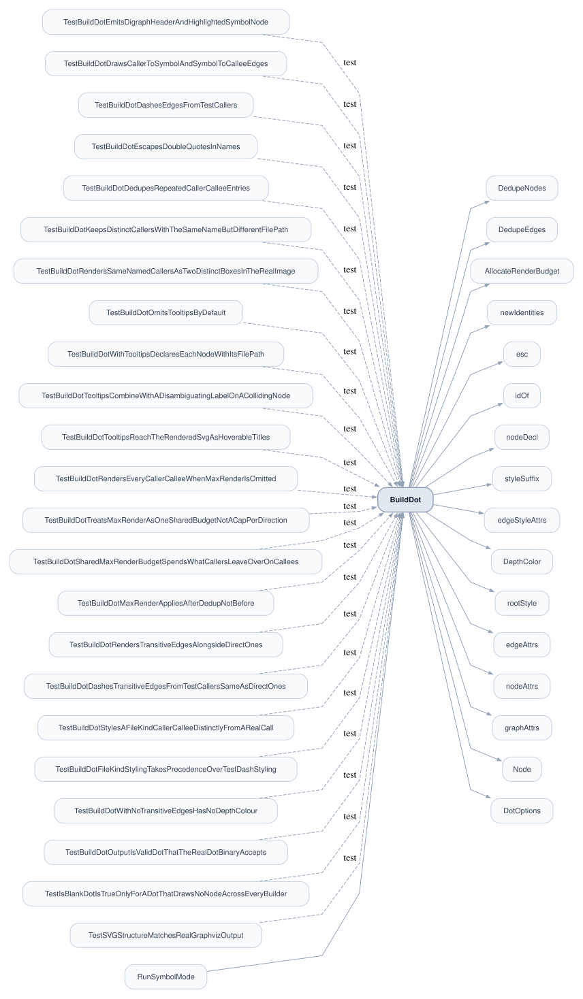
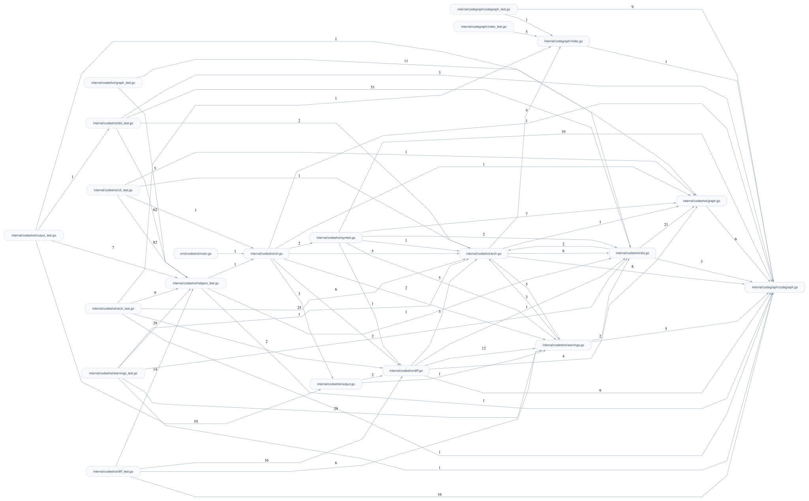

# Technical Reference: Codeshot

## Architecture

Codeshot is a single static Go binary with no server and no persistent state. It reads a CodeGraph index and shells out to two external binaries: `codegraph` (symbol and `--diff` modes, and the symbol enumeration `--architecture` starts from) and `dot` (graphviz). `--diff` also runs `git`.

```
cmd/codeshot/main.go        --- thin main: os.Exit(codeshot.Main(os.Args[1:], os.Stdout, os.Stderr))
internal/codegraph          --- graph-source adapter: the only package that knows CodeGraph's
                                output shapes (CLI runner, JSON types, read-only index read)
internal/codeshot           --- everything else: flag handling, the three modes, DOT builders,
                                warnings, output/embed/check
```

```
argv (symbol, --path, --out, --limit, --max-render, --format, --depth, --max-depth-nodes,
      --embed, --check)
        |
        v
parseArgs / run     --- validates flags and rejected combinations before any codegraph work;
                        works out the output path and --embed marker id
requireOnPath       --- codegraph and dot (and git for --diff); exits 1 with an install hint if missing
FormatMismatchWarning --- warns on stderr if --out's extension disagrees with --format
IndexHealthWarning  --- runs `codegraph status`; warns on stderr (all three modes) if
                        ParseUnresolvedRefs finds references left unresolved by an
                        interrupted index run, since that index silently returns partial
                        callers/callees; a failing status call never blocks rendering
        |
        v
resolveSymbol       --- `query --limit 1 --json` resolves a fuzzy/partial query (e.g. "New")
                        to codegraph's canonical name (e.g. "NewOracle"), used as BOTH the
                        rendered root label and the exact name passed to callers/callees;
                        no result is a clean "not found" exit
        |
        v
Client.Edges("callers"|"callees", ...) --- `callers`/`callees --json`; RunRaw also detects
                        codegraph's plain-text "Symbol not found" and "not initialized"
                        responses and turns them into one-line errors
        |
        v
TruncationWarning (via ReadTruncation: codegraph's own `truncated`/`total` when present,
                   else "result count hit --limit exactly"), EmptyGraphWarning,
AllocateRenderBudget --- splits --max-render as ONE shared allowance across callers,
                   callees and transitive edges (priority order);
                   RenderTruncationNote warns per dimension using its actual allotment
        |
        v
if --depth > 1: collectTransitive("callers") / collectTransitive("callees")
  --- calls callers/callees on each newly discovered node, sequentially, up to --depth hops
      or --max-depth-nodes discovered nodes, producing extra { From, To, Depth } edges;
      DepthBudgetWarning fires if the budget was hit first
        |
        v
BuildDot(resolved, callers, callees, DotOptions)  --- pure function, produces a DOT string
        |
        v
FinishOutput   --- shared by all three modes. Without --embed: renderDot pipes the DOT to
        |          `dot -T<format>` on stdin (no temp .dot file) and writes --out; the path
        |          is printed to stdout. With --embed: ApplyEmbed rewrites the doc's
        |          <!-- codeshot:<id>:start/end --> block (see "--embed / --check" below);
        |          with --check it renders in memory and compares instead of writing
        v
exit 0 (or 1 if --check found drift)
```

Errors are one of two types: `codegraph.FatalError` (one clean stderr line, exit 1) or `codeshot.Exit` (an explicit code plus a stdout/stderr message). `Main` maps both, and any other error, to an exit code.

**`--architecture` mode** is a separate pipeline, dispatched on the boolean flag before the symbol path runs:

```
argv (--architecture, --path, --out, --limit, --max-render, --max-symbols, --group-depth,
      --forbid, --format, --embed, --check)
        |
        v
reject if a <symbol> positional was also given, or --depth / --max-depth-nodes was explicitly set
(--group-depth and --forbid are rejected in the OTHER direction: only with --architecture)
        |
        v
enumerateAllSymbols --- Client.Query(repoPath, 100000, ""): `query --json --limit 100000 -- ''`
  --- an empty-string query WITHOUT --limit silently caps around 50 results regardless of
      repo size; a large --limit makes codegraph return everything (see Known Limitations).
      The result is sorted by SortSymbolsForEnumeration (filePath, then name), because
      codegraph's own order is unspecified and WHICH symbols survive a --max-symbols cut
      would otherwise vary run to run; then sliced to --max-symbols (SymbolBudgetWarning
      if it cut)
        |
        v
collectFileEdges
  --- every enumerated symbol must carry qualifiedName (codegraph 1.6.0+), else a FatalError;
      codegraph.FindIndex walks up from --path to the nearest .codegraph/codegraph.db (as the
      CLI does); codegraph.ReadIndexRows reads every callee-kind edge in one read-only query;
      FileEdgesFromIndexRows derives each definition's answer from those rows.
      No index, or an unreadable schema, is a FatalError too: there is no CLI fallback.
        |
        v
AggregateFileEdges  --- dedupes/sums {FromFile, ToFile} pairs into weighted file edges;
                        drops self-file edges and edges missing a real filePath on either end
        |
        v
ForbiddenEdges      --- checks --forbid rules against the per-file edges, BEFORE rollup and
                        --max-render (those are view choices; ForbidViolationReport prints them)
        |
        v
RollupFileEdges     --- only with --group-depth: rewrites each endpoint to its first N
                        directory segments (GroupPath) and re-sums the weights, dropping
                        self-group edges; GroupCollapseWarning fires if that ate every edge
                        (a blank diagram the FLAG caused, which EmptyArchitectureWarning
                        would otherwise blame on the index)
        |
        v
RenderTruncationNote("files"|"groups", ...) --- warns if --max-render will cut nodes;
HiddenViolationNote --- counts violating edges --max-render leaves out
        |
        v
BuildArchitectureDot(fileEdges, ArchOptions)  --- pure function, produces a DOT string
                        (TopFilesByWeight applies the cap; violating edges drawn red)
        |
        v
FinishOutput        --- shared with symbol mode; with violations the diagram is still
                        written, then the process exits 1
```

**`--diff` mode** is a third pipeline, dispatched the same way (`--diff-ref` implies `--diff`):

```
argv (--diff, --diff-ref, --path, --out, --limit, --max-render, --max-symbols, --format,
      --embed, --check)
        |
        v
gitDiffFiles(repoPath, ref) --- `git diff --name-only -z --end-of-options <ref|HEAD>`
                                (HEAD = working tree, staged + unstaged)
        |  no changed files -> handleEmptyRoots: warn and draw a blank image,
        |  refuse under --embed (never overwrite a real diagram with a blank one),
        |  or report "nothing to check" and exit 0 under --check
        v
enumerateAllSymbols + MatchRootSymbols(symbols, changedFiles) --- the symbols codegraph
                                attributes to a changed file (file- and import-kind entries
                                excluded); zero matches takes the same handleEmptyRoots route
        |
        v
DiffSymbolBudgetWarning --- --max-symbols cap
        |
        v
per root, sequentially: Client.Edges callers + callees (bare name, fatal=false);
a root whose name exists in another file (DuplicateNames, checked against the full
enumerated set) keeps only its own definition's slice (ResolveRootResults, codegraph
with upstream #1801), else falls back to the union;
DiffDuplicateNameWarning (fallbacks only), DiffTruncationWarning (via ReadTruncation)
and DiffEmptyRootsWarning aggregate across roots rather than warning once per root
        |
        v
BuildDiffDot(roots, edges, maxRender, tooltips) --- every root drawn bold, always;
                                --max-render bounds only the callers/callees around them
        |
        v
FinishOutput  --- marker id `diff`, or `diff-<ref>` with --diff-ref
```

**`--embed` / `--check`** (all three modes) live entirely in `FinishOutput`. With `--embed <doc.md>` and no `--out`, the image goes next to the doc instead of a timestamped temp file, named `codeshot-callgraph-<symbol>.<format>` in symbol mode, `codeshot-arch.<format>` / `codeshot-arch-d<n>.<format>` for `--architecture`, and `codeshot-diff.<format>` / `codeshot-diff-<ref>.<format>` for `--diff`. The name carries no checkout directory, so a diagram committed from one clone passes `--check` in another (#51). Without `--embed` the default is `<tmpdir>/<base>-<unix-ms>.<format>`, where `<base>` is `callgraph-<symbol>`, or the `arch`/`diff` id followed by the checkout directory's name. `ApplyEmbed` rewrites the doc's `<!-- codeshot:<id>:start/end -->` block in place (appending one if absent, erroring on a lone start/end marker). The marker id is the symbol name, `arch` (`arch-d<N>` with `--group-depth`), or `diff`/`diff-<ref>`. `--check` renders the diagram in memory and exits 1 if either the image or the doc block is stale, writing nothing. For `svg`, staleness is decided by `SVGStructure` — the sorted node/edge set read from graphviz's `<title>`s — so different graphviz builds on a laptop and CI don't false-drift; other formats fall back to a byte-compare. Before either path writes or compares, `BlankEmbedRefusal` exits 1 if the DOT draws no node (`IsBlankDot`) — the one guard against `--embed` replacing a committed diagram with a blank one (#27). It reads the DOT rather than each mode's data, so a future mode is covered without opting in; `--diff`'s earlier, finer-grained `handleEmptyRoots` still runs first and owns the zero-root `--check` exit-0 case.

See [README.md](README.md#design-decisions)'s "Design decisions" section for why the CodeGraph CLI is the contract, with a direct SQLite index read only for `--architecture`, why Go, and why graphviz instead of a graph-drawing library.

### Example: Codeshot, drawn by Codeshot

The diagram below is not hand-drawn — it is produced by running Codeshot on its own CodeGraph index (`codeshot BuildDot --path . --format svg --out docs/BuildDot-callgraph.svg --embed TECHNICAL.md`) and committed verbatim. It draws the call trail of `BuildDot`, the pure heart of symbol mode:

<!-- codeshot:BuildDot:start -->

<!-- codeshot:BuildDot:end -->

It doubles as a live legend for the [Visual Encoding](#visual-encoding) rules below: callers on the left, callees on the right, a solid indigo arrow for a real call site, a dashed one when the caller looks like test code, and a dotted gray edge labeled `file` when CodeGraph reports only a module-level reference instead of a call. (File-kind styling wins over test dashing — the precedence rule described in [Visual Encoding](#visual-encoding).) Regenerate it any time with the command above; `--check` (see [USAGE.md](USAGE.md)) fails CI if the code drifts from this committed picture.

**Why is the logic in `internal/codeshot` rather than `main`?** `cmd/codeshot/main.go` only calls `codeshot.Main(args, stdout, stderr)` and exits with its return code, so everything else is importable. `BuildDot`, `BuildArchitectureDot`, `BuildDiffDot` and the helpers around them are pure functions of node/edge slices, and `codegraph.Client` takes an injectable `Exec`, so tests can replay codegraph output without the real binary.

## File Descriptions

- **`cmd/codeshot/main.go`** — the entry point described above.
- **`internal/codegraph/codegraph.go`** — the CLI side of the adapter. `Node`, `Response` (a `callers`/`callees --json` body; `Truncated` and `Total` are pointers because "not reported" and `false`/`0` mean different things) and `Definition` (one entry of the per-definition `definitions[]` breakdown from codegraph with upstream #1801). `Client{Exec}` with `NewClient` (runs `codegraph` on `PATH`), `RunRaw`/`RunJSON` (apply the not-initialized and not-found checks; with `fatal=false` those return `ok=false` instead of an error, so a loop over many roots survives one bad name), `Edges`, `Query` (unwraps `query`'s `{node, score}` envelope, dropping only entries with no node or name — a `"kind":"file"` entry is deliberately kept, since file nodes are where calls made from a top-level anonymous callback are attributed) and `Status`. Plain-text matchers: `MatchSymbolNotFound`, `MatchNotInitialized` (stderr of a failed run only, since a successful response can contain the phrase as indexed source), `ArgRepoPath`, `ParseUnresolvedRefs`. `FatalError` is the clean-exit error type.
- **`internal/codegraph/index.go`** — the index side. `FindIndex` walks up from `--path` to the nearest `.codegraph/codegraph.db`. `ReadIndexRows` reads every edge of codegraph's own callee kinds (`calls`, `references`, `imports`, `instantiates`, `navigates`, from its `getCallees`) joined to source and target nodes, in one read-only query via `modernc.org/sqlite` (pure Go, no cgo, so the release binaries cross-compile statically). `IndexRow` is the result; `ErrNoIdentity` is the missing-`qualifiedName` error.
- **`internal/codeshot/cli.go`** — `Main`, `run` (flag validation and rejected combinations, output path and marker id, mode dispatch), `parseArgs`, `requireOnPath`, `Version` (stamped by `-ldflags` at release; `--version`/`-v` prints it).
- **`internal/codeshot/graph.go`** — shared pure helpers: `NodeKey` (the one `name`+`filePath` key every dedupe and `--diff` root lookup shares), `DedupeNodes`, `DedupeEdges` (keyed on `From`+`To`, used for transitive edges), `AllocateRenderBudget` (the shared-budget split, also called from `RunSymbolMode` so its stderr notes report what actually got drawn), `DepthColor` (hop distance ≥2 maps to a progressively lighter shade, clamped at the palette's last entry), `IsTestRef` (a naming-convention check: a `test`/`tests`/`spec` word at the start or end of the name, a `test`/`tests`/`spec`/`__tests__` directory, or a `.test.`/`.spec.` filename), the unexported `identities` (gives each drawn node a graphviz id unique per `name`+`filePath`, so two distinct symbols sharing a name in different files render as two boxes instead of collapsing into one; a name occurring in only one file keeps name-as-id, and a colliding name gains a file-qualified id plus a `name\n(basename)` label), `edgeStyleAttrs` (a `"kind":"file"` node is styled dotted/gray/`"file"` instead of looking like a real call; file-kind styling wins over test dashing), and `SanitizeForFilename`.
- **`internal/codeshot/dot.go`** — `BuildDot` (one symbol's callers/callees plus `TransitiveEdges`; deduplicates, spends `--max-render` through `AllocateRenderBudget`, and with `Tooltips` set — `run` sets it for `svg`/`svgz` only, since graphviz renders node tooltips as `<a xlink:title>` there and ignores them for raster formats — declares each drawn node with its `filePath` as a hover tooltip), `BuildArchitectureDot` (a dedicated function rather than a `BuildDot` branch, since the semantics differ: no root highlight, no caller/callee split, no file-kind concept because every node already is a file; labels edges with their weight, draws test files dashed via `IsTestRef`, and draws `Violating` edges red), `BuildDiffDot` (multi-root: every root bold and always kept, `--max-render` spent only on the callers/callees around them, edges deduped by `NodeKey` so a root-to-root call found from both ends draws once), `IsBlankDot`.
- **`internal/codeshot/symbol.go`** — `RunSymbolMode`, `resolveSymbol`, `collectTransitive`.
- **`internal/codeshot/arch.go`** — `RunArchitectureMode`, `enumerateAllSymbols`, `SortSymbolsForEnumeration`, `collectFileEdges`, and the file-level pure functions. `FileEdgesFromIndexRows` turns index rows into symbol-level file edges: a definition is every node sharing the symbol's name, file and qualified name (codegraph's own overload grouping), counted once; file-kind targets and targets reached only by `imports` edges are dropped. `AggregateFileEdges`, `GroupPath` (a file's first `depth` *directory* segments with a trailing slash, so a group reads as a directory; a repo-root file is returned unchanged, since grouping it under `""` would merge every root file into one nameless box; a file shallower than `depth` keeps the directories it has, so an over-deep `--group-depth` degrades to per-file output instead of erroring), `RollupFileEdges` (re-sums weights per group pair and drops edges that become self-group — the directory-level restatement of `AggregateFileEdges`'s self-file rule; an unset depth returns the input untouched), `TopFilesByWeight` (ranks files by total in+out weight and keeps the top `--max-render`; deliberately a simple weight cutoff, not a centrality algorithm), `ParseForbidRule` / `ForbiddenEdges` / `ViolatingDrawnKeys` (see `--forbid` in Configuration), `ArchOutputBaseName`.
- **`internal/codeshot/diff.go`** — `RunDiffMode`, `gitDiffFiles`, `handleEmptyRoots`, `MatchRootSymbols`, `DuplicateNames` (the set of names defined in more than one distinct **file** — same-file collisions have no attribution ambiguity, so they don't count), `PickDefinitionResult` (the slice of a bare-name `callers`/`callees --json` response belonging to the definition(s) in a file, from the per-definition `definitions[]`, in a shape `ReadTruncation` reads unchanged; `nil` when the response has no `definitions` or none match — see Known Limitations) and `ResolveRootResults` (applies it to each direction independently and reports whether either fell back), and the `Exit` error type.
- **`internal/codeshot/warnings.go`** — every stderr message, as pure functions returning `""` when there is nothing to say: `ReadTruncation`, `TruncationWarning`, `EmptyGraphWarning`, `RenderTruncationNote`, `FormatMismatchWarning`, `DepthBudgetWarning`, `SymbolBudgetWarning`, `EmptyArchitectureWarning`, `GroupCollapseWarning`, `ForbidViolationReport`, `HiddenViolationNote`, `IndexHealthWarning`, the `Diff*` warning/refusal strings, and `BlankEmbedRefusal`.
- **`internal/codeshot/output.go`** — `FinishOutput`, `renderDot` (DOT on stdin to `dot -T<format>`), `ApplyEmbed` (idempotent replace-or-append of the marker block; errors on a half-present pair), `EmbedMarkers`, `EmbedRelLink` (forward-slash relative link from the doc to the image), `SVGStructure` / `DecodeXMLEntities` (the graphviz-version-independent node/edge signature `--check` compares for `svg`).
- **`*_test.go`** — `go test ./...`: unit tests for the pure helpers and the adapter. Tests that need `codegraph`, `dot` or an index of this repo skip themselves when it is missing.
- **`go.mod` / `go.sum`** — one direct dependency, `modernc.org/sqlite` v1.61.1.
- **`action.yml`** — composite GitHub Action: builds `cmd/codeshot` from the action's own checkout (the ref it was pinned to), stamps that ref as the version, and puts it on `PATH`. CI runs it as `uses: ./`.
- **`.runechoguardignore`** — false-positive suppression list for the RunEcho pre-commit symbol-resolution guard (a local hook, not part of codeshot itself).

## External Dependencies

- **[`codegraph`](https://github.com/colbymchenry/codegraph) CLI** — must be on `PATH`; the target repo must already be indexed (`codegraph init`). The minimum supported version is 1.6.0: `--architecture` matches enumerated symbols to index rows by `qualifiedName`, which `query --json` only carries from 1.6.0, and it errors rather than guessing on an older build. Symbol mode at depth 1 makes three sequential calls (`query` to resolve the symbol, then `callers`, then `callees`; `--depth > 1` adds more). The `query` preflight costs real latency (~0.28s on this repo's own index) on every invocation, accepted because skipping it meant `callers`/`callees`' fuzzy-matched root label could show the wrong name entirely. `--architecture` makes one `query` call and one index read. `--diff` makes one `query` enumeration plus a `callers` and a `callees` call per changed symbol. All codegraph calls are sequential: running them in parallel intermittently triggers a `UNIQUE constraint failed: schema_versions.version` error from `codegraph` itself, so concurrent invocations against the same index aren't safe.
- **codegraph's index schema** — `--architecture` reads `.codegraph/codegraph.db` directly (`nodes` and `edges` tables). Unlike the CLI's `--json`, that schema is not a documented contract, so a codegraph release that changes it makes `--architecture` fail with a message naming the database. CI's weekly run against npm `@latest` exists to catch this.
- **`dot` (Graphviz)** — must be on `PATH`.
- **`git`** — only for `--diff`.

`codegraph`, `dot` (and `git` for `--diff`) are checked at startup via `requireOnPath`; a missing binary prints an install hint and exits 1 rather than failing deep in the call stack.

## Configuration

No environment variables, no config file. All behavior is controlled by CLI arguments:

| Flag | Default | Purpose |
|---|---|---|
| `<symbol>` (positional, required unless `--architecture` or `--diff`/`--diff-ref`) | — | The symbol to graph. Forbidden (not just unused) when `--architecture` or `--diff`/`--diff-ref` is set — passing either alongside a symbol is a rejected combination, not a silent ignore. |
| `--path` | `.` (cwd) | Repo path passed through to `codegraph`. An explicit empty value (`--path=`) is rejected with an error rather than silently falling through to `codegraph` as an empty string. |
| `--out` | `<tmpdir>/callgraph-<symbol>-<unix-ms>.<format>` (or `<tmpdir>/arch-<checkoutDir>-<unix-ms>.<format>` for `--architecture`; see `--embed` for the embed default) | Output file path |
| `--limit` | `50` | Max callers/callees fetched from `codegraph` in symbol and `--diff` modes (its own CLI default is 20). Must be a positive integer — rejected with an error otherwise, since `codegraph` silently returns an empty result for a malformed limit rather than erroring itself. **Has no effect in `--architecture`**, which reads the index directly; passing it there prints a warning rather than an error, so v0.3.0 configs that set it keep working. Newer `codegraph` reports truncation outright — its `callers`/`callees` `--json` carries `truncated` and `total` beside the array — and Codeshot uses those when present, so the warning names the real total (`showing 3 of 57 callers … rerun with --limit 57`) and stays silent when nothing was cut. Versions that report neither fall back to the older signal: the result count hitting `--limit` exactly. That fallback guesses in both directions — it warns for a symbol with exactly `--limit` real results and no more, and can never say how many were cut — which is precisely what the reported fields remove. |
| `--max-render` | unset (no cap) | Caps how many *distinct* (post-dedup) nodes are actually drawn, independent of `--limit`. In symbol mode this is **one shared budget across callers, callees, and `--depth`'s transitive edges combined** — not an independent `N` for each dimension (that was the original design, but it let `--max-render 20` draw up to 60 nodes once `--depth` added a third dimension, defeating the flag's purpose of keeping the image readable). Spent in priority order — direct callers first, then direct callees, then transitive edges — so the direct trail is never starved to make room for deeper hops. Exists because `--limit` controls what's fetched, not what's legible. Opt-in and orthogonal to `--limit`: fetch wide (to get an accurate truncation signal) while rendering narrow. Must be a positive integer if given. When it truncates, a stderr warning per dimension states how many of that dimension's distinct total were actually rendered (its real allotment, not the raw `--max-render` value). |
| `--format` | `png` | Passed straight to `dot -T<format>` — no allowlist of its own, so any format `dot -T` supports works, and an unsupported one surfaces `dot`'s own error (which lists the valid ones) rather than a Codeshot-invented one. `svg` is the notable alternative: unlike a raster PNG it stays crisp at any zoom and keeps text selectable, which helps more than `--max-render` alone when a graph is dense but you still want to inspect all of it. |
| `--depth` | `1` (direct-only) | How many hops of callers-of-callers / callees-of-callees to draw beyond the direct trail. Must be a positive integer. `codegraph`'s own `callers`/`callees` have no traversal depth of their own, so Codeshot implements this client-side: `collectTransitive` calls `callers`/`callees` on each newly discovered node, sequentially (see External Dependencies), up to `--depth` hops or `--max-depth-nodes` (below) total discovered nodes, whichever comes first. Fan-out is multiplicative with depth and branching factor, so the budget exists to stop a well-connected symbol at `--depth 3`+ from turning into hundreds of sequential `codegraph` calls; if the budget is hit first, `DepthBudgetWarning` prints a stderr note that the graph beyond that point is incomplete. Each hop beyond the first is drawn in a progressively lighter edge color (`DepthColor`) so distance from the symbol is visible at a glance; `--limit` and `--max-render` are NOT applied per-hop, only globally to the depth-1 fetch/render. Has no meaning with `--architecture` or `--diff` and is rejected if explicitly passed alongside either. |
| `--max-depth-nodes` | `200` | Only meaningful with `--depth > 1`: raises or lowers `collectTransitive`'s total-discovered-node safety cap. Must be a positive integer. Exposed as a flag because a well-connected symbol at `--depth 3`+ can legitimately need a higher cap to finish, a coverage/speed tradeoff only the caller can make. Like `--depth`, it's rejected only when an *explicit, non-default* value is passed alongside `--architecture` or `--diff` (`--max-depth-nodes 200` is a silent no-op). |
| `--architecture` | `false` | Switches to whole-repo file-level dependency graph mode instead of a single symbol's trail — see the second pipeline diagram above. Mutually exclusive with the `<symbol>` positional and with `--diff`. |
| `--group-depth` | unset (one node per file) | `--architecture`-only: rolls each file up into its first N directory segments and draws those as the graph's nodes, summing the weights of every file pair that collapses into the same group pair (`RollupFileEdges`). The answer to the per-file hairball that `--max-render` only half-solves: `--max-render` is lossy at *every* level (the least-busy files are dropped outright, and any edge touching one goes with them), while grouping is lossless at the *module* level specifically — every cross-module call still appears, drawn between directories instead of files. It is not lossless in total: calls that become intra-group are dropped exactly as same-file calls already are, so a grouped diagram's summed weights are legitimately lower (often far lower) than the per-file one's. That difference is the repo's intra-module traffic, and the docs say so, because a user reconciling the two pictures would otherwise read it as a weight-aggregation bug. Composable with `--max-render`, which then caps groups rather than files (`RenderTruncationNote` says `groups`). Must be a positive integer. Rejected — not silently ignored — outside `--architecture`: symbol mode and `--diff` have no file-level graph to roll up, so passing it there is always a mistake, and a silently-dropped flag reads as "grouping applied" in exactly the diagram you would then trust. Applied *after* the file edges are derived, never during, so this stays a pure view over the same data rather than a second scan mode. With `--embed` it claims its own marker id (`codeshot:arch-d<n>`) and default image name rather than the plain `codeshot:arch` — the per-file and per-module pictures answer different questions, so embedding one must not silently overwrite the other's committed block; unset `--group-depth` keeps the original id. |
| `--forbid` | unset (no rules) | `--architecture`-only, repeatable: `FROM->TO` architecture rules (`ParseForbidRule`; a side ending in `/` is a directory prefix, any other side one exact file, a leading `./` is stripped). `ForbiddenEdges` checks them against the per-file edges from `AggregateFileEdges`, *before* `RollupFileEdges` and `--max-render`: those are view choices, and a rule must not pass because the view hid the edge. Each violation is printed by `ForbidViolationReport` (heaviest first, with weight and rule) and drawn red (`#dc2626`, penwidth 1.8 — the one loud color in the muted house style) by `BuildArchitectureDot`'s `Violating` option; `ViolatingDrawnKeys` maps a per-file violation onto the drawn edge, the directory edge under `--group-depth` (one that rolls into a single group isn't drawn). `--max-render` is not overridden to force a violating edge into the picture; `HiddenViolationNote` counts the ones it leaves out, since the exit code already fails the run. With no violations the DOT is byte-identical to a run without `--forbid`, and `SVGStructure` ignores colour, so `--check` is unaffected either way. The diagram is still rendered and embedded, then the process exits 1. Malformed rules and use outside `--architecture` are rejected before any codegraph work. Exact/prefix matching was chosen over globs to keep it predictable. |
| `--max-symbols` | `500` | `--architecture`: caps how many enumerated symbols have their edges included, applied client-side to the path-sorted enumeration; `SymbolBudgetWarning` prints a stderr note when it cuts. Must be a positive integer. **`--diff`/`--diff-ref` reuses the same flag for a differently-scoped budget**: it caps how many *changed, matched* symbols get probed for callers/callees (two calls each), not how many of the whole repo get enumerated — `enumerateAllSymbols` always fetches the full index first so filtering down to the changed files never loses a symbol to this cap before matching happens; `DiffSymbolBudgetWarning` prints the diff-scoped stderr note. Ignored in symbol mode. |
| `--diff` | `false` | Switches to diff-scoped mode: diagrams the symbols codegraph attributes to files `git diff` (working tree vs `HEAD`, no ref) reports changed, each drawn as a bold root with its direct callers/callees fanned out — see `BuildDiffDot`/`RunDiffMode`. `MatchRootSymbols` excludes codegraph's `"kind":"file"` and `"kind":"import"` index entries from becoming roots (an import's text probed as a name can resolve to another symbol and borrow its edges) — otherwise a changed file itself would be drawn as a bold root, since enumeration deliberately keeps file entries for `--architecture`'s sake. Mutually exclusive with `--architecture` and the `<symbol>` positional. `--depth`/`--max-depth-nodes`/`--group-depth` have no meaning here: `--group-depth` is rejected if passed, `--depth`/`--max-depth-nodes` unless left at their defaults. A diff with zero changed files skips the full-index enumeration entirely (it could only ever match nothing); with `--embed` (and not `--check`, which never writes and so has nothing to protect — see `handleEmptyRoots`) it refuses outright rather than rendering a blank diagram over a real, committed one — see `DiffEmbedRefusal`/`DiffEmbedRefusalNoSymbols` (the latter for the same zero-roots outcome when real changed files match no indexed symbol). A changed root with no callers/callees still draws (a lone box). Roots with no edges (`DiffEmptyRootsWarning`) and roots whose fetch was cut off by `--limit` (`DiffTruncationWarning`, decided by `ReadTruncation` as in symbol mode) are each reported once in aggregate rather than per root, to avoid stderr noise on a large diff. |
| `--diff-ref` | unset | Implies `--diff`; gives `gitDiffFiles` an explicit ref/range (e.g. `origin/main...HEAD`) instead of the default `git diff --name-only -z --end-of-options HEAD` (working tree — staged and unstaged — vs `HEAD`; deliberately NOT bare `git diff`, which diffs against the index and silently misses fully-staged changes). `--end-of-options` closes off an argv-injection risk: without it, a `--diff-ref` value starting with `-` (e.g. templated from untrusted CI input) is parsed by git as a flag instead of a revision — the same class of risk `resolveSymbol`'s `--` guards against for `codegraph`, just using git's own equivalent flag since a bare `--` there would mark `ref` as a pathspec instead of a revision. `-z` gives NUL-terminated, unquoted path output, sidestepping `core.quotePath`'s default C-style octal-escaping of non-ASCII filenames (which would be mangled and unmatchable against codegraph's `filePath`). The ref form is what to use for `--embed --check` in CI, where there is no working tree to diff against and the default would make the check flap for reasons unrelated to the code. Must not be empty if given. Also suffixes `--diff`'s `--embed` marker id and default output filename (`codeshot:diff-<sanitized-ref>` / `codeshot-diff-<ref>.<format>`) so two differently-scoped diagrams can be embedded in the same doc without colliding — same reasoning as `--group-depth`'s `arch-d<n>` marker. |
| `--embed <file.md>` | unset | Writes the diagram into an **existing** markdown doc between `<!-- codeshot:<id>:start/end -->` markers, refreshing in place on re-runs (see `FinishOutput` above). Without `--out`, the image lands next to the doc so the relative link resolves (name pattern under `--embed` / `--check` above); that name has no checkout directory, so it is the same in every clone. A missing doc or a lone start/end marker is an error, not a silent create/mangle. Works in all three modes. |
| `--check` | `false` | Only with `--embed`: regenerate in memory, exit 1 naming what is stale (image, doc block, or both), exit 0 if current; writes nothing. `svg` compares graph structure (`SVGStructure`), other formats compare bytes and so need the same graphviz version on both ends. |
| `--version`, `-v` | — | Prints `codeshot <version>` and exits. The version is stamped into the binary at release time. |

## Visual Encoding

Beyond the direct-call edges (solid indigo) and dashed test-caller edges (see README), one more distinction is drawn straight from data codegraph already returns: an edge whose node has `"kind":"file"` — codegraph's way of reporting a module-level/import reference instead of a real function-level call site (common for framework dependency-injection patterns, e.g. FastAPI's `Depends()`, where codegraph can't resolve the real caller function) — is rendered dotted, gray (`#9ca3af`), and labeled `"file"`, so it reads as "codegraph found *some* relationship here, but not a verified call" rather than looking identical to a confirmed function call. This takes precedence over the test-dash styling when a node is both (rare, but a test file's own file-level reference would otherwise be ambiguous which signal wins).

`--architecture` mode's encoding is simpler, since every node is already a file (no root-symbol highlight, no caller/callee direction split): each edge is labeled with its call-count weight (how many distinct symbol-level calls between that pair of files were aggregated into it), and a file whose path matches `IsTestRef`'s heuristics is drawn dashed — the same test-detection logic as symbol mode, just applied to the file itself rather than a caller node. Under `--group-depth` the encoding is unchanged, only the unit is: a node is a directory (rendered with its trailing slash, `test/`, so it can't be misread as a file), the weight is the summed call count between two directories, and the dashed styling still comes from `IsTestRef` — which reads path segments, so a `test/` group matches like any file under it. An edge that violates a `--forbid` rule is drawn red.

## Maintenance Commands

```bash
go test ./...         # unit tests; tests needing codegraph, dot or an index of this repo skip themselves
gofmt -l .            # CI fails if this prints anything
go vet ./...
go build -o /tmp/codeshot ./cmd/codeshot
codeshot <symbol> --path <repo> --out /tmp/out.png                    # manual smoke test, symbol mode
codeshot --architecture --path <repo> --out /tmp/arch.svg --format svg   # manual smoke test, architecture mode
codeshot --architecture --path <repo> --group-depth 1 --format dot       # manual smoke test, directory-rollup view (prints DOT source)
codeshot --diff --diff-ref HEAD~1 --path <repo> --out /tmp/diff.svg --format svg  # manual smoke test, diff mode

# Regenerate this doc's two committed diagrams after a code change (CI runs the same two commands with --check appended):
codeshot --architecture --path . --max-symbols 5000 --format svg --out docs/architecture.svg --embed TECHNICAL.md
codeshot BuildDot --path . --format svg --out docs/BuildDot-callgraph.svg --embed TECHNICAL.md
```

CI (`.github/workflows/ci.yml`) has three jobs. `test` runs `gofmt`, `go vet`, `go test ./...` (no codegraph, so the end-to-end tests self-skip) and golangci-lint v2.15.0. `test-npm-codegraph` runs `go test ./...` again with npm codegraph 1.6.0 installed and this repo indexed, so the end-to-end tests run; a weekly scheduled run swaps in unpinned `@latest`, to catch an upstream release that changes the output codeshot parses or the index schema `--architecture` reads. `diagrams` is a separate blocking job: it builds codegraph from the inth3shadows/codegraph fork at `v1.6.0-em.8` (pinned by SHA, WASM-only — npm 1.6.0 plus unreleased upstream fixes including #1801, so `--diff`'s per-definition path runs in CI), builds a fresh index and `codeshot`, and runs both diagram commands above with `--check`, so a PR that changes the call graph without regenerating the committed SVGs fails. The committed diagrams must be regenerated with that same build. Pushing a `v*` tag runs `.github/workflows/release.yml`, which runs the tests, cross-compiles six static binaries (linux, darwin and windows, amd64 and arm64; `CGO_ENABLED=0`) with the version stamped in by `-ldflags`, writes `checksums.txt`, and publishes them as a GitHub Release.

There is no service to restart, no rollback beyond installing a prior release or git ref, and no other services, logs, or scheduled jobs to maintain — see [README.md](README.md#install) for the install command itself.

## Known Limitations

- Tests that need `codegraph` run only where it is installed and this repo is indexed (they skip themselves otherwise, since a fresh clone won't have either). In CI that is the `test-npm-codegraph` job; the plain `test` job covers `BuildDot` and the other builders only against the real `dot` binary.
- `IsTestRef` is a naming-convention heuristic (a `Test`/`Spec` word at the start or end of the name, or a `test`/`tests`/`spec`/`__tests__` directory or `.test.`/`.spec.` filename), not a semantic check — a production symbol that happens to follow test-like naming (e.g. a function literally named `Test`) would still be misclassified.
- **Real, verified codegraph indexing gaps that codeshot has no way to detect or correct, and silently renders as if they were the whole truth** (found by testing codeshot against `runecho`, `codegraph-upstream`, `honeyslate`, and `secret-broker` — real external repos, not this one): same-named methods on unrelated classes/types are sometimes merged into one node, sometimes one is silently dropped, inconsistently between cases; aliased imports (`from x import load as load_config`) can return zero callers for a function with several real call sites; and confirmed-real call sites (verified by reading the actual source) are sometimes simply missing from `codegraph callers`'s response, and from the index `--architecture` reads, with no indication anything was omitted. None of these are fixable from codeshot's side — it only draws what `codegraph` returns — but they're worth knowing before trusting a sparse-looking graph as complete.
- **Committed diagrams and the `--check` that guards them must use the same codegraph build.** Different builds can index the same repo into different edges (the CI fork is npm 1.6.0 plus unreleased fixes), so a diagram regenerated with one fails `--check` against the other. `--diff` differs more: see its entry below. For `svg`, `--check` compares graph structure, so graphviz versions don't matter; for any other format it compares bytes, so the graphviz version must match too.
- `--depth`'s traversal treats `--limit`/`--max-render` as global, not per-hop — a symbol with a huge fan-out at hop 2 fetches up to `--limit` results for *each* newly discovered node at that hop, which is the main driver of `--max-depth-nodes` exhaustion; there's no independent per-hop limit to trade off against total node count (though the total budget itself is configurable — see `--max-depth-nodes` above).
- A cyclic call graph (recursion, or A and B calling each other) can cause `--depth`'s transitive traversal to rediscover the root symbol or an already-drawn depth-1 node as a "from"/"to" endpoint of a deeper edge. This is harmless (graphviz just draws the extra edge; `DedupeEdges` still collapses exact repeats) but can occasionally show what looks like a redundant edge back into an already-visible node.
- **`--architecture` needs codegraph 1.6.0+ and a readable index, and fails otherwise instead of falling back.** It errors (exit 1, one line) when the enumerated symbols carry no `qualifiedName` (codegraph before 1.6.0), when no `.codegraph/codegraph.db` exists at or above `--path`, or when the schema can't be read (for example, a newer codegraph changed it). Same-named symbols are told apart by index identity (name, file and qualified name), not by a per-name CLI probe: same-named definitions in different files, and same-named *files*, each get their own edges, and overloads grouped by codegraph into one definition count once. Two same-named symbols in one file that codegraph reports as separate definitions are counted separately.
- **`--architecture` includes file nodes' own edges, specifically to catch calls made from inside a top-level anonymous callback** (e.g. `test('...', () => { realCall() })` — a common pattern in test suites). codegraph attributes such a call to the enclosing file, not any named function, since no named function contains it; without the file node as a source, `--architecture` would be blind to that category of real cross-file dependency. File-kind *targets* are dropped: the same unverified-reference status that makes symbol mode draw them dotted/gray means they must not count as a real cross-file edge here either. File nodes also compete with real symbols for the same fixed `--max-symbols` slot budget, in the path-sorted order described below — on a repo near the cap, file nodes can crowd out real-symbol coverage with no warning distinguishing the two.
- **A file that only imports from another draws no edge to it.** Index rows reached only through an `imports` edge are dropped, so an imported symbol the file never calls, references or instantiates adds nothing; one that is also called counts once per definition. The counted edge kinds are `calls`, `references`, `instantiates` and `navigates`.
- **`--architecture`'s enumeration query (`codegraph query --json --limit <big> -- ''`) has confirmed, inconsistent `--limit` behavior worth knowing before trusting it.** Without `--limit`, an empty-string query silently caps around 50 results regardless of actual repo size (confirmed on a real 1,870-node index). Passing a large `--limit` (confirmed with both 500 and 2000 against that same index) instead returns *every* result codegraph has — more than the requested number, not capped at it. Codeshot works around this by always passing a very large `--limit` (100000) to force the "return everything" behavior, then applying the real `--max-symbols` cap client-side. The *order* codegraph returns results in is unspecified, which would make the kept subset not reproducible: the same unchanged repo could yield a different diagram run to run, and a diagram guarded by `--check` in CI could fail for no code reason at all. `SortSymbolsForEnumeration` sorts by `filePath`+`name` before the slice, so the kept subset is a deterministic function of the index alone. What that does **not** fix: the subset is still a *prefix*, a path-ordered one, so on a repo larger than `--max-symbols` the diagram covers the alphabetically-first files rather than an even sample across the repo. Raise `--max-symbols` if you need the whole picture. (`--limit` does not apply here; it has no effect in `--architecture`.)
- **`--diff` mode resolves colliding root names by file on a codegraph with upstream #1801, and falls back to the bare-name union otherwise (every npm release through 1.6.0).** Roots are fetched with plain `codegraph callers`/`callees --json <name>`, which answers a name defined in several files with the union of every definition's edges (measured on a two-`parse` fixture: changing only `a/parse.js` drew `b/parse.js`'s callee `beta` and caller `useB` on the changed root — 6 edges where 3 were real). Upstream codegraph PR #1801 (merged 2026-09-08, after the 1.6.0 npm release, and in the inth3shadows fork) added a per-definition breakdown to that same response (`definitions[]`, each with its own `filePath`, list, `total` and `truncated`), so for a root whose name also exists in another file — checked against the **full enumerated symbol set**, not just roots-vs-roots, so a collision with an unrelated unchanged symbol counts — `PickDefinitionResult` keeps only the definition(s) in the root's own file. Each direction is resolved independently by `ResolveRootResults`: a direction with no per-file answer keeps the union and gets the root named in the warning, and a null (not-found) direction adds no edges either way. The same post-1.6.0 codegraph's `callers`/`callees -f <file>` flag was rejected: on no match it silently returns every definition (`filteredOut: true`), whereas selecting from `definitions[]` client-side yields an explicit no-match, and passing `-f` would make npm 1.5.0/1.6.0 reject the call outright. On npm codegraph (1.6.0) or when no definition's `filePath` matches, the root keeps the union and `DiffDuplicateNameWarning` names it; with two same-named roots that union is attached to BOTH in full. Because the two codegraph versions draw different edges for a colliding root, a `--diff --embed` diagram regenerated with one will fail `--check` in a CI running the other; keep the builds matched.
- **`--diff` mode's changed-file matching is an exact string comparison** (`MatchRootSymbols`, after normalizing backslashes to `/`) between `git diff`'s output and codegraph's `filePath` field. It has no tolerance for the two being relative to different roots (e.g. `--path` pointing at a subdirectory of the git repo) — a real risk in the same family PR #24 fixed for `--architecture`'s file attribution, not yet verified against a repo where `--path` and the git root diverge.
- **`--diff --max-render`'s budget for non-root nodes is a flat slice over the combined caller/callee list in probe order, not fair across roots.** A diff touching several files can let the first-probed root(s) consume the entire `--max-render` allowance, leaving later roots rendered with none of their own callers/callees and no per-root indication of the starvation — the same "simpler than a fair/centrality allocation, by design" tradeoff `TopFilesByWeight` already accepts for `--architecture`.

<!-- codeshot:arch:start -->

<!-- codeshot:arch:end -->
